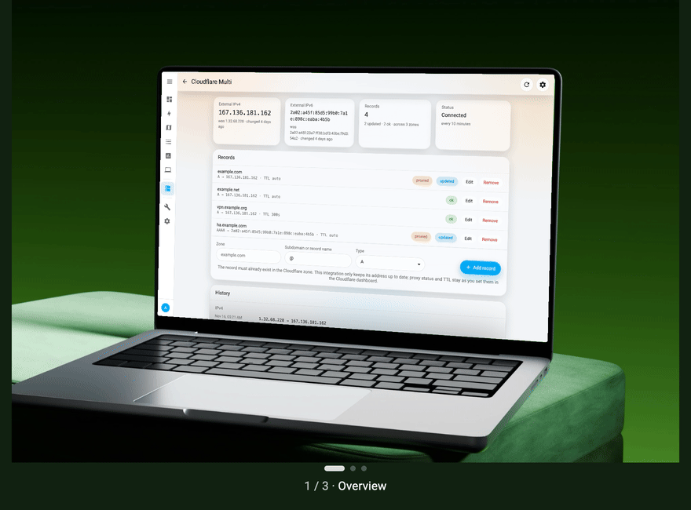
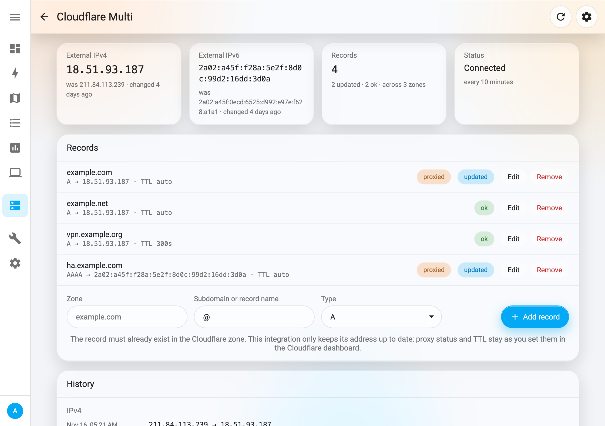
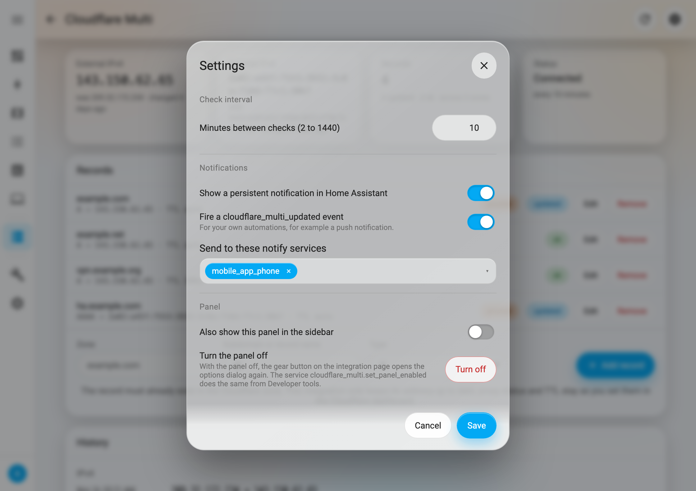
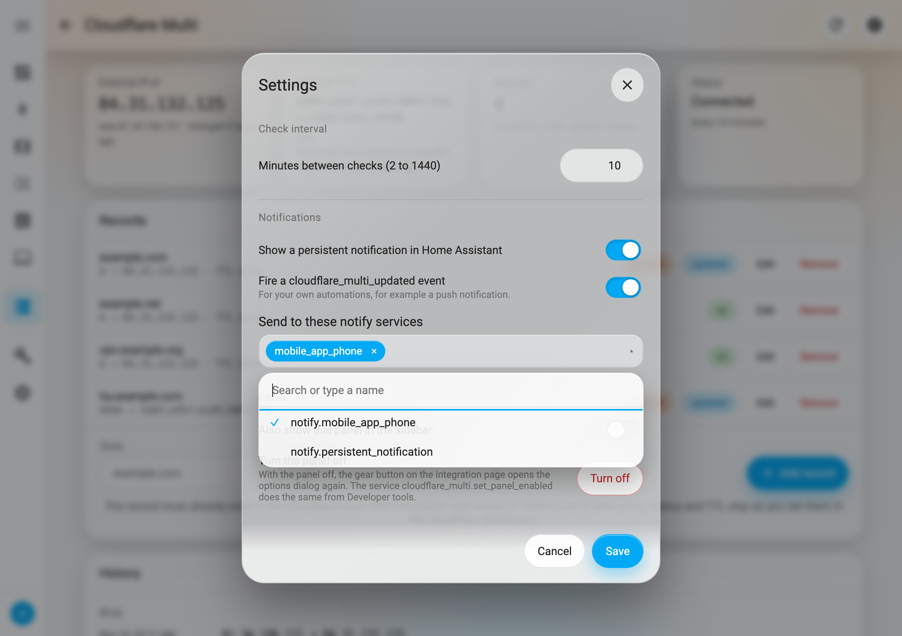

# Cloudflare Multi Dynamic DNS

<p align="center">
  <a href="../../releases/latest"></a>
  <a href="../../actions/workflows/validate.yml"></a>
  <a href="../../actions/workflows/hassfest.yml"></a>
  
  
</p>

A Home Assistant custom integration that watches your external IP address and keeps your **Cloudflare** DNS records pointing at it. It authenticates with a scoped API token, checks your address on a schedule, and updates an `A` or `AAAA` record only when the address has actually changed.

Unlike the built-in Cloudflare integration, one account here covers **as many zones as you like**: records from different domains sit side by side in a single config entry.

<p align="center">
  
</p>

<p align="center">
  <a href="https://my.home-assistant.io/redirect/hacs_repository/?owner=joohann&repository=cloudflare-multi-ddns&category=integration"></a>
</p>

> Unofficial. Not affiliated with or endorsed by Cloudflare.

## Features

**Keeps DNS in sync**
- `A` and `AAAA` records across as many Cloudflare zones as you like, all in one account
- Only writes to the Cloudflare API when the address changed, so nothing is touched on a quiet day
- Leaves proxy status and TTL exactly as the Cloudflare dashboard has them; this integration owns the address and nothing else
- Remembers the last 20 address changes per address family, across restarts

**Its own panel**
- The gear on the integration page opens a full page instead of a dialog, the way ZHA and Z-Wave JS do
- Add, edit and remove records, change the interval, pick notify services, all without leaving the page
- Proxied records carry an orange label, so you can see at a glance which ones sit behind Cloudflare
- Optional sidebar entry; the panel can be switched off again from inside itself

**Tells you when it changes**
- A persistent notification in Home Assistant
- A `cloudflare_multi_updated` event for your own automations
- A direct message to any `notify.*` service you select

**Entities**
- Current and previous external IPv4 and IPv6, with the time of the change
- One sensor per managed record, carrying its status, its previous address, its zone and record id, and whether it is proxied

## The panel

<p align="center">
  <picture>
    <source media="(prefers-color-scheme: dark)" srcset="docs/panel-overview-dark.png">
    
  </picture>
</p>

Addresses, records and history at a glance. The tiles show what the address is now and what it replaced, plus how many zones the records are spread over. Each record carries its own status, with **Edit** to load it back into the form and **Remove** to drop it. Records that Cloudflare proxies are marked in orange, and the TTL is shown as the dashboard reports it.

<p align="center">
  <picture>
    <source media="(prefers-color-scheme: dark)" srcset="docs/panel-settings-dark.png">
    
  </picture>
  &nbsp;
  <picture>
    <source media="(prefers-color-scheme: dark)" srcset="docs/panel-notify-dark.png">
    
  </picture>
</p>

Every setting lives in one dialog. Notify services are a combobox with search; typing a name that is not in the list offers to add it, so a service that is not registered yet can still be configured.

## Installation

**HACS**

1. HACS, three dots, **Custom repositories**
2. Add `https://github.com/joohann/cloudflare-multi-ddns` as an **Integration**
3. Install **Cloudflare Multi Dynamic DNS**, then restart Home Assistant

**Manual**

Copy `custom_components/cloudflare_multi` into your `config/custom_components/` folder and restart Home Assistant.

## Setup

First, in the Cloudflare dashboard under **My Profile → API Tokens → Create Token**:

1. Create a token with **Zone → DNS → Edit** and **Zone → Zone → Read**, scoped to the zones you want to manage, or to all zones.
2. A Global API Key is not used here, and will not work.
3. Make sure the record you want to keep updated **already exists** in the zone. This integration updates the content of an existing record; it never creates one.

Then in Home Assistant: **Settings → Devices & services → Add integration → Cloudflare Multi Dynamic DNS**, paste your API token, and add your first record. The zone field offers every zone the token can see.

A record is a zone plus a name: `@` for the zone apex, or a label such as `www` or `home`. Cloudflare stores the full hostname, and the integration works that out for you.

## Options

Open them with the gear on the integration page. With the panel switched on, that gear opens the panel; with it off, you get the usual options dialog.

| Setting | Default | Notes |
| --- | --- | --- |
| Records | the one you added during setup | zone, subdomain and type per record |
| Check interval | 10 minutes | 2 to 1440 |
| Persistent notification | on | shown in Home Assistant when a record is updated |
| `cloudflare_multi_updated` event | on | for your own automations |
| Notify services | none | any `notify.*` service, or a name you type yourself |
| Panel | off | replaces the options dialog with the panel |
| Panel in sidebar | off | the panel stays reachable from the gear either way |

The panel needs Home Assistant **2026.10 or later**, which is when the frontend started honouring `config_panel_domain`. Everything else works from **2026.4** onwards.

## Entities

| Entity | What it holds |
| --- | --- |
| `sensor.<account>_external_ipv4` | the address now, with `previous_ip` and `changed_at` as attributes |
| `sensor.<account>_external_ipv6` | same, for IPv6 |
| `sensor.<account>_previous_external_ipv4` | the address it replaced (diagnostic) |
| `sensor.<account>_previous_external_ipv6` | same, for IPv6 (diagnostic) |
| one sensor per record | its current content, plus `status`, `fqdn`, `zone_id`, `record_id`, `proxied`, `ttl`, `previous_ip`, `last_updated` and `error` |

Record status is one of `ok`, `updated`, `record_not_found` or `error`. Each zone becomes its own device, under the account.

## Services

```yaml
# Check now instead of waiting for the interval
action: cloudflare_multi.refresh

# Turn the panel off again, for when its JavaScript does not load
action: cloudflare_multi.set_panel_enabled
data:
  enabled: false
```

Both take an optional `entry_id` to limit them to one account.

## Events

```yaml
trigger:
  - trigger: event
    event_type: cloudflare_multi_updated
# event.data: domain, name, type, old_ip, new_ip
```

## Troubleshooting

**The panel stays empty.** Reload the integration and do a hard refresh in the browser; the panel is served with a version based on the file's timestamp, and your tab may still hold the old module.

**I cannot reach the options any more.** With the panel on, it replaces the options dialog. Switch it off inside the panel, or call `cloudflare_multi.set_panel_enabled` with `enabled: false` from Developer tools.

**Record not found.** The record has to exist in the Cloudflare zone first. Create it once in the dashboard with any content; the integration takes it from there.

**Zone not found or not accessible.** The API token cannot see that zone. Check the token's zone scope, and that the zone name matches exactly, without a trailing dot.

**An AAAA record while your provider has no IPv6.** The external IPv6 lookup then fails and the whole check fails with it, so your `A` records are not updated that round either. Remove the `AAAA` record if you do not actually have IPv6.

## Development

The panel is a plain ES module, no build step. Pure logic lives in modules without Home Assistant imports, so the tests run on their own:

```bash
cd custom_components/cloudflare_multi/tests && python3 -m unittest discover
python3 custom_components/cloudflare_multi/tools/i18n_check.py
```

`tests/panel-harness.html` runs the panel against a mocked Home Assistant with a stand-in sidebar, and `tests/mockup-macbook.html` puts that harness inside the laptop photo. Serve the integration folder over HTTP and open them; ES modules do not load over `file://`.

Every user visible name lives in `const.py`. Renaming the integration is a change in that one file, plus the panel's own file name.
